

  <a href="https://protfolio-site-seven.vercel.app/"></a>

### I build AI systems that hold up under scrutiny.

AI/ML engineer · B.S. Computational Data Science, Penn State (Dec 2027) · from Lahore.
Computer vision on live CCTV, agents that cite their sources, models that explain themselves. Every claim below has evidence filed behind it.

**Status:** open to Summer 2027 ML / software internships · [portfolio](https://protfolio-site-seven.vercel.app/) · [LinkedIn](https://www.linkedin.com/in/ammar-sheikh-703247317) · [email](mailto:ammarsaboor40@gmail.com)

---

#### `FIELD ACTIVITY`

  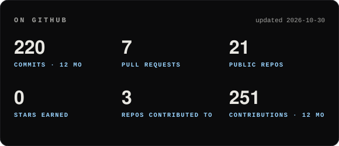
  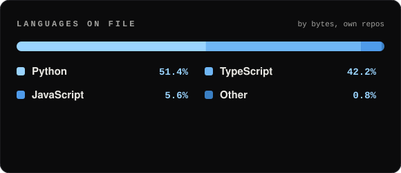

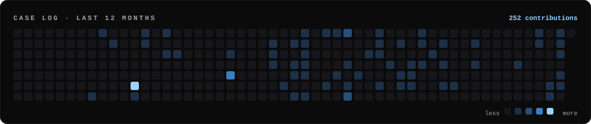

#### `OPEN SOURCE`

**[HAX The Web](https://github.com/haxtheweb/issues/issues/2947), haxcms-nodejs** (Aug 2026, accepted by the maintainers): PowerPoint deck import for HAX sites, so slide decks embed accessibly as text. Speaker-notes extraction, a per-slide deck manifest, a new `import-pptx-deck` API endpoint with OpenAPI docs, a fix for decks of 10+ slides coming out misordered, and 11 new tests. 604 lines across 7 files.

#### `CASE FILES`

<table>
  <tr>
    <td width="50%"><a href="https://github.com/ammarsapru/Waypoint">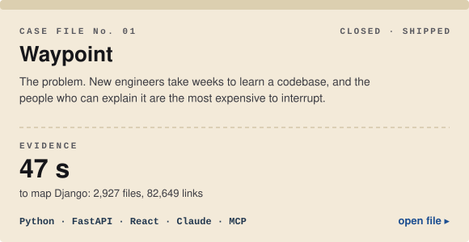</a></td>
    <td width="50%"><a href="https://huggingface.co/ammarsapru/AI_OR_NOT_CLASSIFICATION">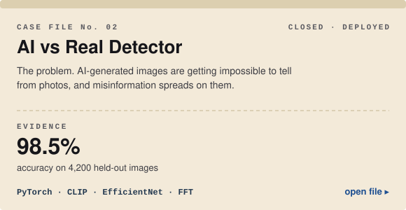</a></td>
  </tr>
  <tr>
    <td><a href="https://github.com/ammarsapru/AI_FOR_ALZHEIMERS">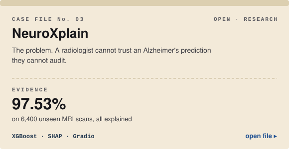</a></td>
    <td><a href="https://github.com/ammarsapru/Arena">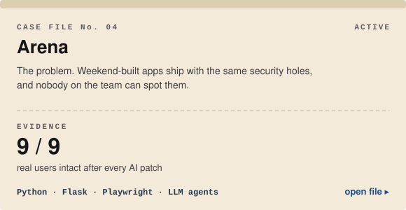</a></td>
  </tr>
  <tr>
    <td><a href="https://github.com/ammarsapru/alethia-main">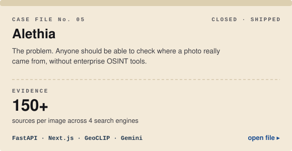</a></td>
    <td><a href="https://github.com/ammarsapru/Brainstorm">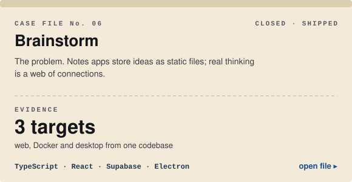</a></td>
  </tr>
</table>

**More on the wall:** [Global Watch](https://github.com/ammarsapru/GLobal-Watch), a voice-driven country-intelligence globe · [Synapse Mail](https://github.com/ammarsapru/Synapse_mail), an agentic email and calendar client · [Internship Tracker](https://github.com/ammarsapru/Internship_tracker), an AI-assisted job pipeline · [AxiomTalent](https://github.com/ammarsapru/AxiomTalent), three-LLM resume consensus · [NewsVeritas](https://github.com/ammarsapru/NewsVeritas), a fake-news classifier with label leakage removed · [Kestrel](https://github.com/usmannsiddiqui/kestrel), HackPSU 2026 robot science playground

#### `THE EVIDENCE BENCH`

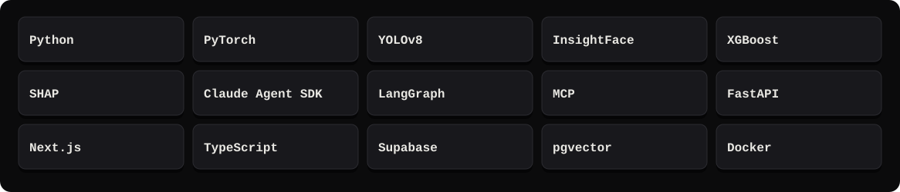

#### `THE RECORD`

<table>
  <tr>
    <td width="62%">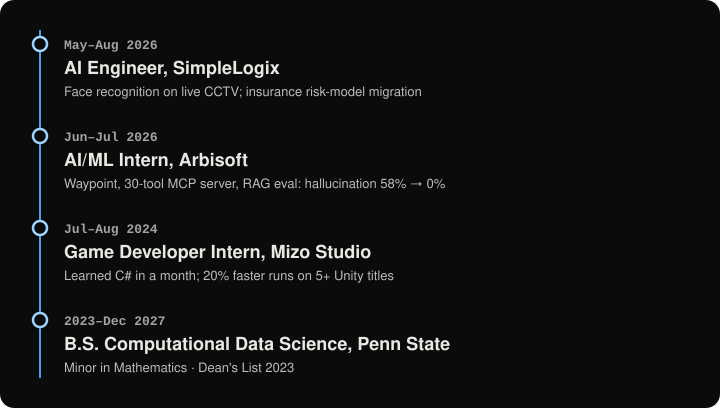</td>
    <td width="38%">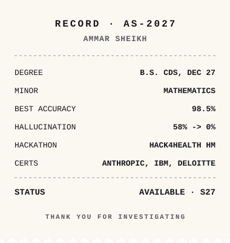</td>
  </tr>
</table>

#### `LEAVE A TIP`

Got a case that needs cracking? [ammarsaboor40@gmail.com](mailto:ammarsaboor40@gmail.com) · [LinkedIn](https://www.linkedin.com/in/ammar-sheikh-703247317) · [Devpost](https://devpost.com/ammarsapru) · [Hugging Face](https://huggingface.co/ammarsapru) · [the full investigation board](https://protfolio-site-seven.vercel.app/)

Stats and languages refresh daily from the GitHub API. Everything else is drawn from <code>profile.json</code>.
